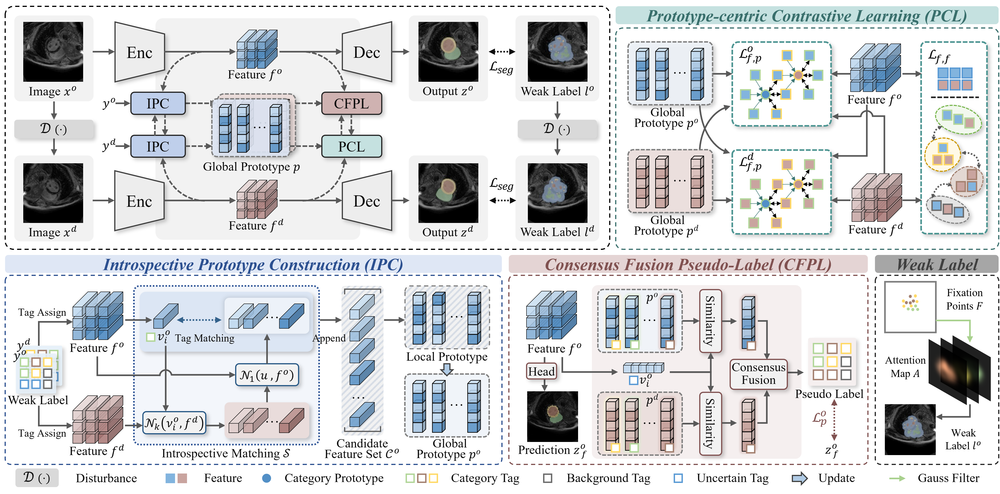

# InPro: Introspective Prototype-guided Framework with Consensus Pseudo-Label for Gaze-Supervised Cardiac Segmentation

> Cardiac segmentation is an essential step in cardiovascular disease diagnosis, but creating fully annotated labels remains time-consuming and expensive, underscoring the necessity for innovative strategies that reduce dependence on dense annotations. 
Eye-tracking provides a cost-effective source of supervision that can be seamlessly integrated into radiologists' workflows without additional annotation burdens. Gaze signals implicitly encode diagnostic attention, providing weak yet semantically informative cues for model optimization. 
Nevertheless, in multi-class settings, the inherent sparsity and ambiguity of gaze limit supervision quality, leading to class diffusion and inaccurate segmentation of spatially adjacent regions.
To address these challenges, we propose the Introspective Prototype-guided framework (InPro) for gaze-supervised cardiac segmentation. Specifically, the introspective prototype construction module constructs reliable prototypes by exploiting similarity queries across inter-view features with an
introspective matching strategy. To further mitigate ambiguity in gaze, the consensus fusion pseudo-label module infers labels in uncertain regions via multi-prototype consensus, enhancing supervisory
signals.
Finally, to reduce class confusion, prototype-centric contrastive learning (PCL) is employed to promote intra-class feature compactness and maximize inter-class feature separability.
Experimental results on two public cardiac datasets and two public general medical datasets demonstrate that InPro outperforms state-of-the-art methods for gaze-supervised medical image segmentation.

# Model Weights
The download links and extraction codes for our model weights are as follows：[Checkpoint](https://pan.baidu.com/s/1cRE9u6sSXicBgcr9r1AgjA?pwd=7777)

# Datasets
1. The MSCMR dataset with mask annotations can be downloaded from [MSCMRseg](https://zmiclab.github.io/zxh/0/mscmrseg19/data.html).
2. The ACDC dataset with mask annotations can be downloaded from [ACDC](https://www.creatis.insa-lyon.fr/Challenge/acdc/).

The gaze annotations for both the ACDC and MSCMRseg datasets can be downloaded from [Gaze](https://pan.baidu.com/s/1hGczmx0iRVhT8YJazbUi0g).

## Qualitative Results

## Requirements
* python 3.8  
* torch 1.12.0 
* numpy 1.24.4 
* medpy 0.5.1 
* nibabel 5.2.1 
* pandas 2.0.3 
* scikit-image 0.21.0 

## Acknowledgement
This repo partially uses code from [CycleMix](https://github.com/BWGZK/CycleMIx).
